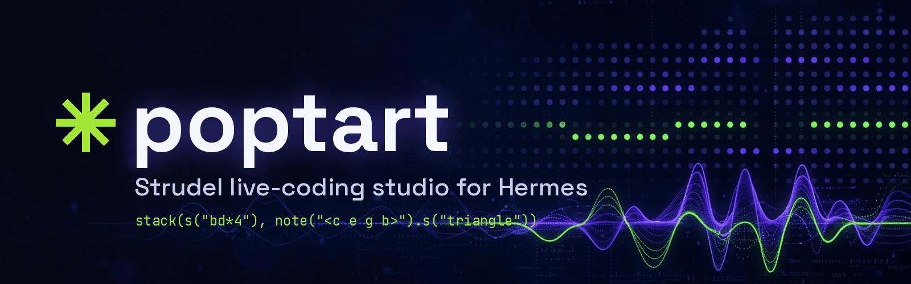
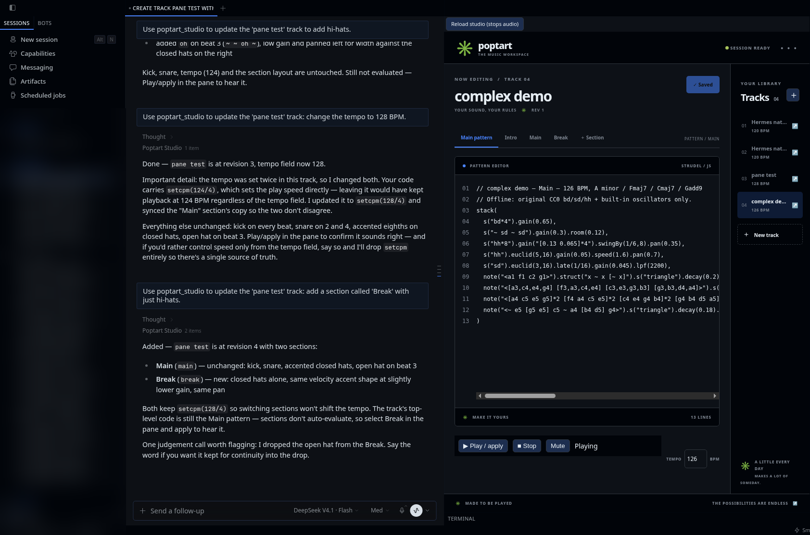
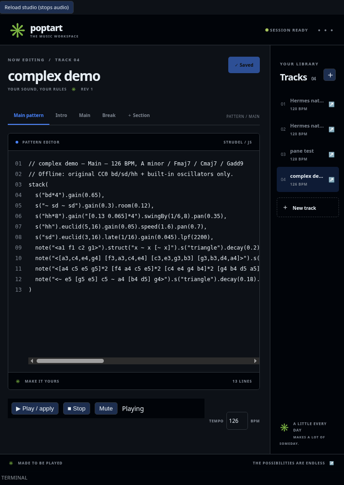
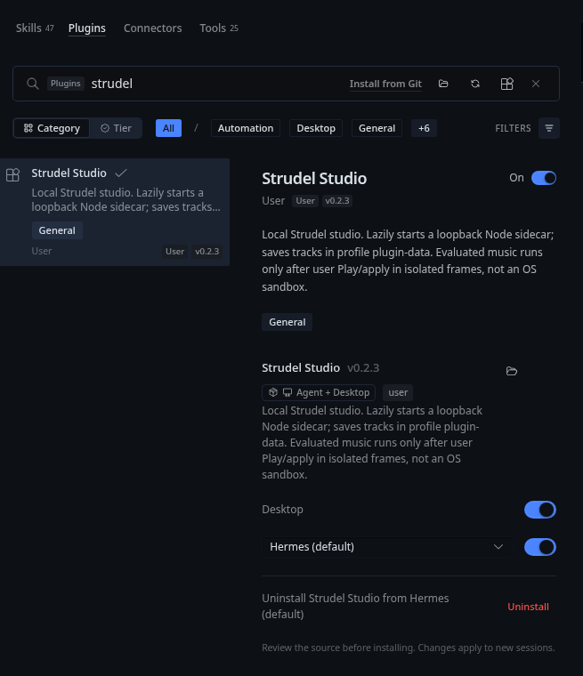
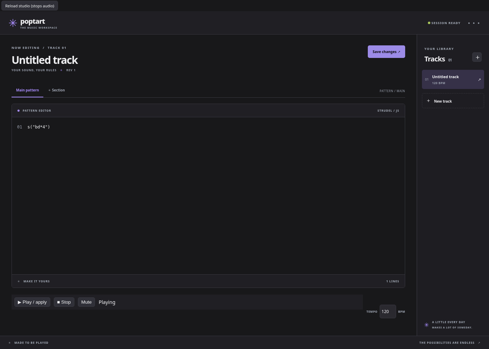
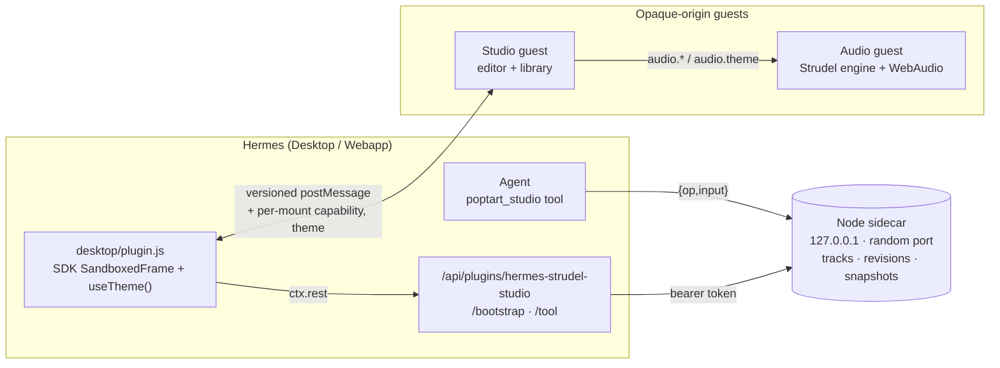

<div align="center">



**A local [Strudel](https://strudel.cc) live-coding studio: write patterns, hit Play, and let your Hermes agent compose alongside you.**

[](LICENSE)
[](integration/hermes/plugin.yaml)
[](INTEGRATION.md)
[](package.json)
[](#quick-start-standalone-studio)

<br>



<sub>Strudel Studio docked in the Hermes webapp. The agent edits the track with <code>poptart_studio</code> while the pane plays it.</sub>

</div>

---

## Why poptart

Strudel is a fantastic way to make music in code. poptart turns it into a **workspace**: tracks that persist, revisions that guard against overwrites, sections you can switch between, and a clean agent API. Your Hermes agent can draft a beat, add a break or change the tempo. You stay in control, because nothing plays until *you* press Play.

<div align="center">
<br>
<sub>Close-up: a 126 BPM, three-section track playing, with the library on the right.</sub>
</div>

## Features

- 🎛️ **Live-coding editor.** Strudel/JS pattern editor with line numbers, a tempo field and Play / apply, Stop and Mute transport.
- ✨ **Tokens light up as they play.** Scheduler-synced mini-notation highlights use your Hermes accent. Stop clears them; editing pauses highlights until the buffer matches the last applied code (or you apply successfully).
- 🛟 **Edits can't kill the groove.** An invalid edit (syntax or runtime error) keeps the last good pattern playing and shows the error separately.
- 🗂️ **Track library.** Persistent tracks, each with a **revision** number, **snapshots** with restore, and named **sections** (for example Intro / Main / Break).
- 🤖 **One composable agent tool.** `poptart_studio` covers 11 ops behind a single `{op, input}` call, with a **127-token** schema (o200k_base).
- 🧩 **Native Hermes pane.** Desktop/Webapp `SandboxedFrame` pane with the library on the right, which stacks below the editor in narrow panes.
- 🎨 **Follows your Hermes theme.** Colours come from the Hermes SDK `useTheme()` painted palette and update live without stopping audio, with a dark fallback.
- 🔒 **Local-first.** Loopback-only Node sidecar, a private per-install token, and no hosted AI service.
- 🔊 **Offline sounds.** Three small original CC0 synthesized samples plus Strudel synths, all bundled locally.

<div align="center">
<table>
<tr>
<td align="center"><br><sub>Installed and enabled in Hermes (v0.2.3)</sub></td>
<td align="center"><br><sub>Right-hand library layout (packaged player, headless test)</sub></td>
</tr>
</table>
</div>

## Quick start (standalone studio)

You don't need Hermes for this. It requires **Node 22+** and npm.

```sh
git clone https://github.com/mojomast/poptart.git && cd poptart
npm ci
npm run service      # terminal 1, loopback music service on 127.0.0.1:4311
npm run dev:host     # terminal 2, studio plus mock Hermes host on :5173
```

Open **http://127.0.0.1:5173/**, create a track, and click **Play / apply**. Browsers require a user gesture before audio can start. Click it again to apply edits. **Save** writes to `data/tracks.json`. The mock host also lets you simulate agent tool calls (see [`server/README.md`](server/README.md)).

> [!WARNING]
> This setup is for loopback development only. Don't expose the service or Vite to a network. Strudel code is JavaScript and runs in isolated frames, but that is **not** an OS sandbox.

## Install as a Hermes plugin

The installable plugin is the self-contained, committed **`integration/hermes`
directory**, not the repo root. Catalog installs need **Node 22+**, not npm or a
local build. Source contributors regenerate and verify it with `npm ci`,
`npm run build`, and `npm run build:check`; see [INTEGRATION.md](INTEGRATION.md).

**Option A: from the Hermes catalog** *(pending: available once the catalog PR is merged)*

```sh
hermes plugins install hermes-strudel-studio --enable
```

**Option B: manual (clone + symlink)**

```sh
git clone https://github.com/mojomast/poptart.git && cd poptart
npm ci && npm run build
ln -s "$PWD/integration/hermes" ~/.hermes/plugins/hermes-strudel-studio
hermes plugins enable hermes-strudel-studio
hermes plugins doctor
```

`hermes plugins install` takes a catalog name, Git URL or owner/repo, not a local path. Use the symlink for a local checkout.

The backend and the Desktop pane are each opt-in; the Desktop contribution ships with `defaultEnabled: false`. Turn on the pane under **Capabilities → Plugins → Strudel Studio → Desktop**, then Rescan or reload.

> [!IMPORTANT]
> **Restart `hermes-gateway` after a backend route change on an already-mounted plugin.** Hermes won't hot-remount a mounted plugin API namespace, so changed `/api/plugins/hermes-strudel-studio/*` routes stay stale until the gateway restarts. On a first install, hot-mount may work; if the pane reports a backend error, restart `hermes-gateway`. Frontend-only updates only need a Rescan or Webapp reload, then a pane reload. Reloading the pane stops its audio.

To turn it off: `hermes plugins disable hermes-strudel-studio`. Full details are in [INTEGRATION.md](INTEGRATION.md).

## Tool reference: `poptart_studio`

Every call is `{ "op": ..., "input": {...} }`. Fields are exact, and unknown keys are rejected (Draft 2020-12 validation runs before any request). Results always include `{ok, error, code, fix}`, and successful results also carry `data`.

| op | input | what it does |
|---|---|---|
| `list` | `{}` | List tracks |
| `get` | `{trackId}` | Read one track (code, tempo, sections, revision) |
| `create` | `{title, code, tempo, sections}` | New track. Tempo 20–400; sections `[{id,name,code}]` need unique ids |
| `update` | `{trackId, expectedRevision, changes}` | Change title, code, tempo or sections (non-empty) |
| `update_section` | `{trackId, expectedRevision, sectionId, section:{name,code}}` | Edit one section |
| `sections` | `{trackId}` | List a track's sections |
| `snapshot` | `{trackId, expectedRevision}` | Save a snapshot of the current revision |
| `snapshots` | `{trackId}` | List snapshots |
| `restore` | `{trackId, snapshotId, expectedRevision}` | Restore a snapshot |
| `analyze` | `{trackId}` | Static counts (no audio analysis) |
| `export` | `{trackId}` | Export the **code** (never audio) |

**Error codes the agent should handle:**
- `CONFLICT`: re-read the track and preserve human edits. Never overwrite blindly.
- `VALIDATION_ERROR`: fix the fields.
- `SERVICE_UNAVAILABLE`: check the build and Node. The service is never auto-restarted.

There is deliberately **no** delete, shell, remote-playback or audio-export op. Agent edits persist but never auto-play: a human still presses Play / apply.

## Architecture



- **Pane:** the host bridge mounts a scripts-only, opaque-origin `SandboxedFrame` with no same-origin access, no referrer and no permission delegation. Messages are version 1, source-checked, size and concurrency bounded, and bound to a random per-mount capability.
- **Routing:** the pane talks only to the Hermes origin (`/bootstrap` returns a self-contained, credential-free guest document, and `/tool` runs the same strict router as the native tool). The browser never contacts the sidecar.
- **Sidecar:** one lazily started Node process under a startup file lock. It binds only to 127.0.0.1 on an OS-chosen port, and no systemd unit is added.
- **Audio:** a separate opaque `srcdoc` child running bundled Strudel (`@strudel/*`), samples and worklets. It receives no capability or credentials.

More detail is in [ARCHITECTURE.md](ARCHITECTURE.md).

## Security & privacy

| | |
|---|---|
| **Network** | The sidecar listens on loopback only. The Python client bypasses ambient HTTP proxies. No hosted AI service is called. |
| **Token** | A random 256-bit per-install `service.token` lives in Hermes plugin data with mode **0600**. It's never logged, returned, or sent to the renderer, editor or audio guest. |
| **Isolation** | Both guests run in opaque origins with scripts only. Other or opaque browser origins are rejected by the sidecar on their own, even with a token. |
| **Environment** | Provider credentials are stripped from the sidecar's environment. |
| **Theme** | Only allowlisted colour tokens and font-family names are forwarded. No custom CSS, external font URLs, host DOM reads or settings writes. |
| **Caveat** | Strudel patterns are JavaScript. The frames isolate them from Hermes, but they aren't an OS sandbox, so review untrusted code before you play it. Patterns may explicitly reference remote resources. |

## Testing

```sh
npm test                          # Node service tests (7)
npm run build                     # typecheck, Vite build, package plugin
python -m pytest -q tests/plugin  # Python plugin tests (12)
python scripts/measure-schema.py  # tool schema size (127 o200k_base tokens)
npx playwright install chromium
npm run test:desktop              # packaged Desktop SDK-contract harness
npm run test:standalone           # standalone production-asset regression
npm run test:browser              # needs service + dev host running
```

The browser suites check for non-zero audio in headless Chromium, confirm that playback survives invalid edits, and check opaque-frame API denial, theme application and the right-hand layout. Evidence and limits are in [TEST_REPORT.md](TEST_REPORT.md).

## Troubleshooting

| Symptom | Fix |
|---|---|
| No sound | Click **Play / apply** first, since browsers need a gesture. A remote Webapp needs a secure context (HTTPS or a localhost tunnel). |
| Pane reports a backend error (first install, or after a backend route update) | Restart `hermes-gateway`. Hermes won't hot-remount an already-mounted plugin API. |
| Pane shows the old UI | Rescan or reload the Webapp, then reload the pane. |
| `SERVICE_UNAVAILABLE` | Check `npm run build` and Node. Restart the sidecar only deliberately, keep tracks and the token, and never start a second owner on the same store. |
| `CONFLICT` | Someone (maybe you) edited first. Re-read with `get` and retry with the new `expectedRevision`. |
| Don't tunnel the sidecar port | The pane only needs the Hermes connection. |

## Known gaps & roadmap

- Not yet verified: physical speaker output, OAuth-specific routing, native-Desktop data-document worklets, and non-Chromium browsers.
- No level meter yet.
- No WebSocket: the pane uses bounded 3-second refresh polling.
- The editor is a textarea, not CodeMirror.
- Remote gateway setups are untested.
- Third-party license review is ongoing (see [RESEARCH.md](RESEARCH.md) and [THIRD_PARTY_LICENSES.md](THIRD_PARTY_LICENSES.md)).

## Credits

Built on **[Strudel](https://strudel.cc)** by the TidalCycles community. Thanks to them for bringing TidalCycles-style patterns to the browser. poptart runs inside [Hermes Agent](https://github.com/NousResearch/hermes-agent). See [NOTICE](NOTICE) and [THIRD_PARTY_LICENSES.md](THIRD_PARTY_LICENSES.md).

## License

[AGPL-3.0-or-later](LICENSE). No warranty. More docs: [Architecture](ARCHITECTURE.md) · [Hermes integration](INTEGRATION.md) · [Handoff](HANDOFF.md) · [Tests](TEST_REPORT.md)
